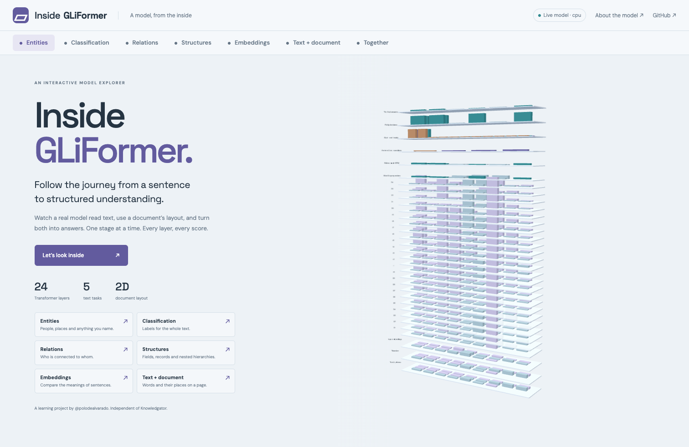
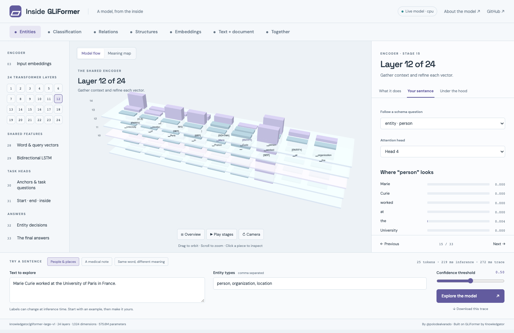
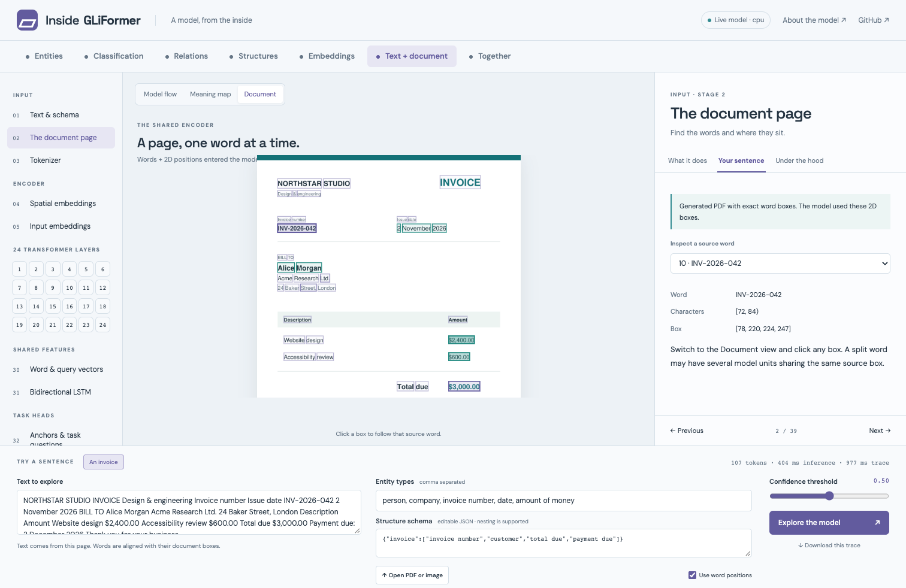
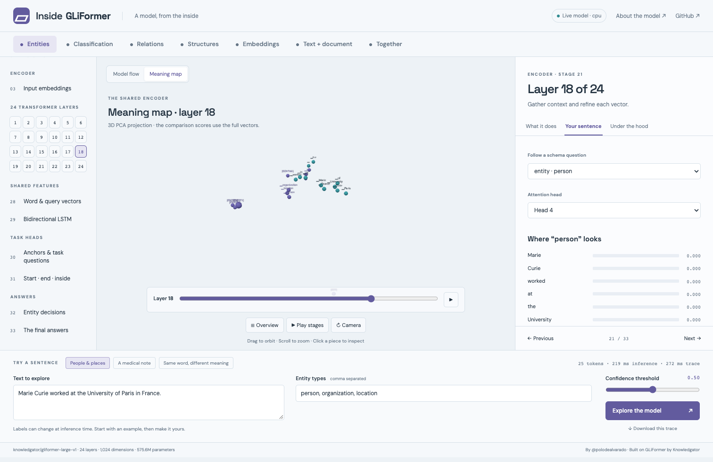
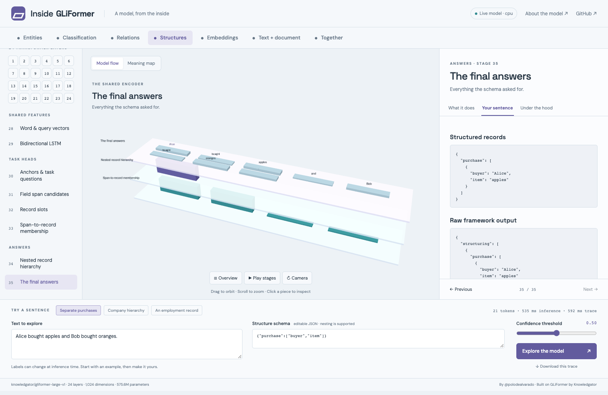
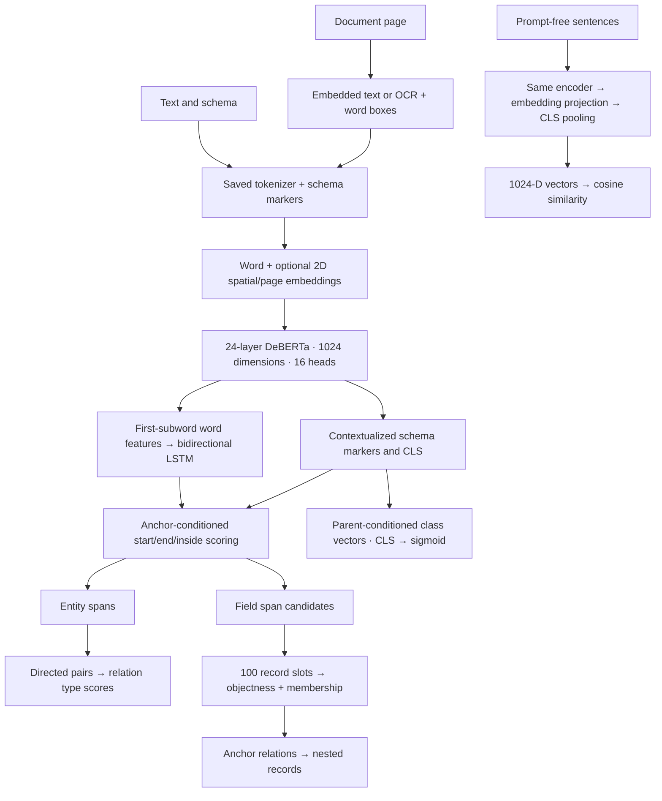

<div align="center">

# Inside GLiFormer

**Follow a real model from text and document layout to structured answers.**

[](https://github.com/polodealvarado/gliformer-visualizer)
[](https://huggingface.co/knowledgator/gliformer-large-v1)
[](https://github.com/Knowledgator/GLiFormer)



</div>

An interactive 3D walkthrough of **Knowledgator’s GLiFormer Large v1**: 575.6 million parameters, 24 Transformer layers, five text tasks and a layout-aware document encoder.

Write a sentence and a schema, or open a document page. The real model runs, and the app captures the actual hidden states, attention probabilities, word features and task scores. Select any stage to read what it does, inspect your sentence’s values, or follow the implementation at its pinned source revision.

This is a separate project inspired by [Inside GLiNER2.5](https://github.com/polodealvarado/gliner2-visualizer). Its backend and explanations follow GLiFormer’s architecture.

## Run locally

```bash
git clone https://github.com/polodealvarado/gliformer-visualizer.git
cd gliformer-visualizer
uv sync
uv run server.py
```

Open **http://localhost:8766**. The first run downloads the public checkpoint, approximately 2.3 GB. Later runs use the Hugging Face cache. Python 3.12 and dependencies are managed by [uv](https://docs.astral.sh/uv/).

```bash
uv run server.py --offline           # use the cached, pinned checkpoint
uv run server.py --check             # real-model checks across all seven task tabs
uv run server.py --port 8767         # choose another port
```

The live server defaults to localhost, CPU inference and four PyTorch threads. Use `--host 0.0.0.0` for a container. The UI uses vendored Three.js and has no JavaScript build step. Web fonts are optional; system fonts work offline.

## What you can explore

| Task | Input question | Captured stages |
|---|---|---|
| Entities | “Find people, organizations and locations.” | Schema anchors, start/end/inside scores, exact source spans |
| Classification | “Is this science, business or sports?” | CLS pooling, label logits, sigmoid probabilities and decisions |
| Joint relations | “Who works for whom?” | Detected entity spans, directed pairs and per-relation scores |
| Structures | “Which buyer bought which item?” | Field BIO scores, spans, 100 record slots, objectness and membership |
| Nested structures | “Which employees belong to each department?” | Anchor connections, hierarchy diagnostics and nested output |
| Embeddings | “Which sentences mean similar things?” | Prompt-free encoding, projected CLS vectors and full-vector cosine similarity |
| Text + document | “Where are the invoice fields on this page?” | Word boxes, spatial embeddings and extraction over text plus geometry |
| Together | Several extraction tasks | Shared encoder output, then each requested head |

The tower lets you step through every layer, play the stages, orbit and zoom, inspect individual pieces, choose a schema marker, and inspect any of the 16 attention heads. The meaning map projects hidden states into 3D and aligns successive layers so movement is easier to follow.

<table>
<tr><td width="50%"></td><td width="50%"></td></tr>
<tr><td align="center"><sub>Attention inside the shared encoder</sub></td><td align="center"><sub>Document words and their 2D geometry</sub></td></tr>
<tr><td></td><td></td></tr>
</table>

## Text and images: the exact scope

The model is **layout-aware DeBERTa**, with text and bounding-box inputs. The app supports:

- **PDFs:** read embedded text and word coordinates; choose a page from a multipage document.
- **PNG, JPEG and WebP:** run local Tesseract OCR to obtain words and boxes.
- **Scanned PDFs:** render the selected page and use the same OCR route.
- **A built-in invoice:** a generated page with exact text geometry, available without OCR.

Boxes are normalized to 0–1000 and aligned to the model’s word units and subword tokens. Click a word on the displayed page to inspect its offsets and box. Toggle **Use word positions** and rerun to compare the real model’s behavior with and without geometry.

Select a Transformer layer while the Document view is open to overlay query-to-word attention directly on the page. Query and head selectors use the same actual attention tensors as the tower.

**The page image is a visual reference. This checkpoint does not encode image pixels.** Its spatial embeddings describe word positions, width, height and page identity. Other GLiFormer variants support vision and audio, but those heads are absent from this checkpoint.

Install Tesseract to use images or scanned PDFs:

```bash
brew install tesseract                    # macOS
# Debian / Ubuntu: apt-get install tesseract-ocr
```

The Docker image includes Tesseract. The Python server keeps uploaded pages in memory and does not save them. Downloading a trace explicitly saves its input, page image and outputs.

## The actual architecture



See [the complete architecture analysis](docs/architecture.md) for tensor shapes, source locations, decoder rules, layout alignment and the capture contract.

## Real data and deliberate simplifications

- The full token-to-token attention matrix is the mean across 16 heads. Individual head views contain actual query-to-word attention, summed over each word’s subword pieces.
- Hidden-state strips display 32 of 1,024 dimensions. Vector bars rescale their height for readability; hover values retain their original numeric scale.
- The meaning map uses PCA on normalized token vectors. It is an approximation of geometry, not a sentence-embedding similarity metric.
- The sentence comparison uses cosine similarity in the full 1,024 dimensions. Sentence embeddings use a separate prompt-free encoder pass.
- The app uses flat entity decoding. It displays the framework’s actual predictions; it does not repair mistakes or substitute handcrafted outputs.
- The page lists the strongest relation and record candidates when a panel would otherwise be too large. Downloaded traces retain every captured pair, candidate, slot and hierarchy score.
- The checkpoint is documented for English. Other-language inputs are experiments, with no multilingual quality guarantee.

Limits keep the walkthrough readable: 120 whitespace words, 180 model word units, 320 subword tokens, 24 schema labels/fields, three classification groups and five comparison sentences. Document files may be up to 10 MB; image pages may contain up to 16 million pixels.

## Static playback

The repository includes compressed traces generated by the real model. A static HTTP server can serve the UI without Python model dependencies:

```bash
python3 -m http.server 8767
```

Open http://localhost:8767. The UI detects the absence of `/api/info`, loads `static/manifest.json` and plays the recorded examples. Text, schemas, thresholds and document uploads are disabled in this mode. Task, stage, attention, map and document-box controls remain interactive.

To regenerate the examples with the exact checkpoint:

```bash
uv run server.py        # first terminal
uv run bake.py          # second terminal
```

`bake.py` writes one gzip JSON trace per example, a generated document and a provenance manifest. This avoids inventing intermediate activations for an offline demonstration.

## API

`GET /api/info` exposes runtime dimensions, parameter counts, package versions and model/source revisions. `GET /api/examples` exposes the examples used by both live and static modes.

```http
POST /api/analyze
Content-Type: application/json

{
  "text": "Marie Curie worked at the University of Paris in France.",
  "entities": ["person", "organization", "location"],
  "relations": ["works_at", "located_in"],
  "classes": {"topic": ["science", "sports", "business"]},
  "structures": {"scientist": ["name", "organization", "country"]},
  "threshold": 0.5
}
```

The response contains input/schema, source words and character offsets, tokenizer pieces, schema markers, 25 hidden-state snapshots, 24 attention snapshots, word-RNN before/after strips, head scores, decoded results and provenance.

`POST /api/document` accepts `{name, data, page}` where `data` is base64 file content and `page` is zero-based. It returns an image, text and aligned word boxes. Pass that object as `document` to `/api/analyze`, with its exact `text` and an optional `use_layout` boolean.

## Validation

```bash
uv run pytest
uv run ruff check server.py documents.py bake.py scripts tests
uv run server.py --offline --check
uv run python scripts/browser_qa.py       # requires the live server and Chrome
uv run python scripts/document_qa.py      # PDF, page selection, image OCR and real-model alignment
uv run python scripts/verify_traces.py    # numeric/source invariants across all 17 recorded traces
```

The browser check covers every task, all explanation tabs, real attention-head selection, the meaning map, document-box selection, geometry enabled/disabled, a custom sentence, mobile overflow and JavaScript errors. The model check performs real inference for all task tabs. Baking also exercises every preset, including the nested company schema.

## Container

```bash
docker build -t gliformer-visualizer .
docker run --rm -p 7860:7860 gliformer-visualizer
```

The image installs CPU PyTorch, Tesseract and the pinned model. It runs the real-model check during the build. The Docker recipe is provided for deployment; local Python and browser validation are the verified development path.

## Provenance and credits

- Model: [`knowledgator/gliformer-large-v1@d0a4e53d`](https://huggingface.co/knowledgator/gliformer-large-v1/tree/d0a4e53d09cebe6bc963dd9be319d4279084bb2d).
- Framework source: [`Knowledgator/GLiFormer@73d1dad5`](https://github.com/Knowledgator/GLiFormer/tree/73d1dad5ebf1f34a00339f023b1fd77a6d1f386a), Apache-2.0.
- Three.js r160: MIT, license preserved under `vendor/`.

Created by [@polodealvarado](https://huggingface.co/polodealvarado). This is an independent educational project and is not affiliated with Knowledgator. Model weights remain in the Hugging Face cache and are not included in this repository.
